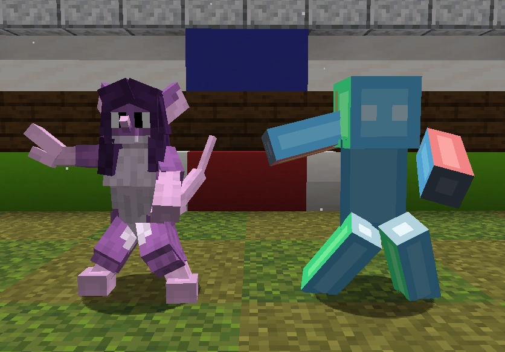

# Animation Mirror API

A Figura API that lets people mirror each other's animations! It features **rig retargeting**, so it should work across all humanoid rigs!

The whole point of this API is that it does not require you have someone's animations in your avatar to be able to mirror them, but it does require you both have animation mirror in your avatars to work.

# Choose what you want to be mirrored, and who by

Animation Mirror is essentially a global switch you turn on (via code) when you want to be mirrored, you choose when this switch is on. When it is on, every motion you make will be mirrored, whether that's blockbench animations, procedural animations, or even parent types. If it moves your model, it moves anyone mirroring it.

Animation Mirror allows you to choose who you want to be able to mirror you, you do this by implementing an allow function. If you want a blacklist or a whitelist, username or UUID based, or a completely different system, you can implement whatever you want, however you want.

# Things to note

This API is **NOT meant for beginners!** I tried to make it easy to use but couldn't, if you don't have basic lua knowledge, you're not gonna be able to use this API.

Animation Mirror is quite heavy on instructions, rig retargeting isn't cheap!

This API has many files. While a lot of them are optional, avatar space is a genuine concern.

# Installation and Usage

[General overview](docs/how_to_use.md) (start here)

[Functions, events and other misc things](docs/reference_hub.md) (Full documentation)