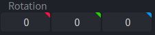
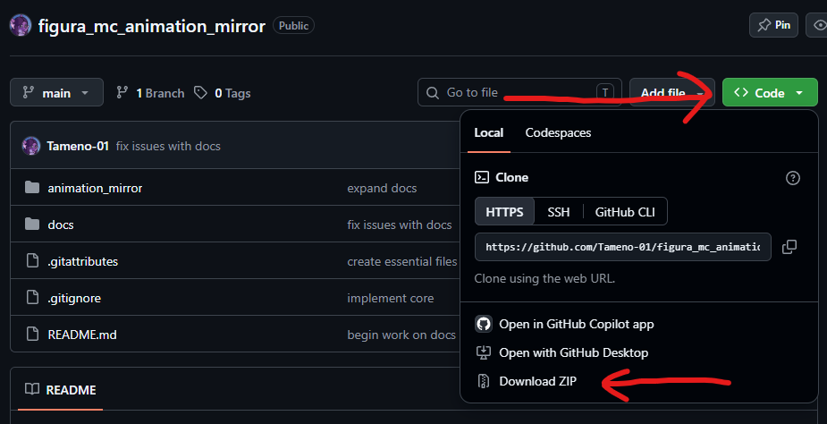

# How to use

I know it's long, but please read try to read this whole guide, it should cover everything.

**Installation** is covered in step 1.

# Step 0: Rig Requirements

Sadly, not all rigs are compatible with Animation Mirror. For starters, they all have to be humanoid, the more your rig deviates from a human, the more likely animation mirror does not support it.

**Things animation mirror does support:**

- Vanilla-styled rigs (no elbows, no hands, no knees, no feet and no articulation for the torso)
- Fully articulated rigs (with elbows, hands, knees, feet and a torso with any number of spine joints)
- Arms with elbows but no hands
- Legs with knees but no feet
- Digitigrade legs (with or without feet/toes)

Additionally, it is worth noting that all of the above can be mixed and matched at will. For example, if your avatar has a single-joint torso, fully rigged arms, and legs with knees but no feet, that's perfectly fine.

## Step 0.1: Temporarily set all joints's rotation to 0

Animation Mirror does not care what rotations joints have in blockbench, however, the **rest pose** of your model does matter. To see this pose and verify it is supported, set their rotation to 0. This should be the state they're all already in.



## Step 0.2: Valid rest poses

Animation mirror treats each body part as a separate, individually configurable thing, more precisely, it considers the following parts: Head, torso, left arm, right arm, left leg and right leg.

Depending on which style of rig each part has, what's considered a valid rest pose is different. The following are precise definitions of the valid rest poses each type of rig can have, categorized by body part. You only need to read the ones that apply to your rig.

**Head:**

- [Vanilla](head/vanilla_rig_requirements.md) (Head can detach for more expressiveness)
- [Rigged](head/rigged_rig_requirements.md) (Head stays in place, can optionally have a neck)

**Torso:**

- [Vanilla](torso/vanilla_rig_requirements.md) (Single joint)
- [Rigged](torso/rigged_rig_requirements.md) (2 or more joints)

**Arms:**

- [Vanilla](arm/vanilla_rig_requirements.md) (Single joint)
- [Rigged](arm/rigged_rig_requirements.md) (With an elbow joint and an optional hand)

**Legs:**

- [Vanilla](leg/vanilla_rig_requirements.md) (Single joint)
- [Rigged](leg/rigged_rig_requirements.md) (With a knee joint and an optional foot)
- [Digitigrade](leg/digitigarde_rig_requirements.md) (Animal legs)

## Step 0.3: Set rotations back to what they were

You may now undo what you did in step 0.1 (if you had any rotated joints in the first place).

# Step 1: Install the API

Go to the [main page](https://github.com/Tameno-01/figura_mc_animation_mirror) of this repo and click on the `<> Code` button, then `Download ZIP`.



Extract the zip and locate the folder called `animation_mirror`. it may be inside one or several sub-folders. Place the `animation_mirror` folder in your avatar's root folder, the same folder containing the `avatar.json` file.

# Step 2: Make the body

In Animation Mirror, "making" a body refers to gathering all the information performing the setup necessary to read and set its pose.

It is recommended you put all the following code snippets in either your main lua file or a lua file created specifically for animation mirror.

## Step 2.1: Make the body parts

You "make" a body by "making" 6 body parts, the head, the torso, the left arm, the right arm, the left leg and the right leg.

Depending on what type of rig each of those parts has, the setup is slightly different, so i've written separate guides for all supported types of rig. 

**Head:**

- [Vanilla](head/vanilla_setup.md)
- [Rigged](head/rigged_setup.md)

**Torso:**

- [Vanilla](torso/vanilla_setup.md)
- [Rigged](torso/rigged_setup.md)

**Arms:**

- [Vanilla](arm/vanilla_setup.md)
- [Rigged](arm/rigged_setup.md)

**Legs:**

- [Vanilla](leg/vanilla_setup.md)
- [Rigged](leg/rigged_setup.md)
- [Digitigrade](leg/digitigrade_setup.md)

## Step 2.2: Make and assign the full body

First, require the body maker.

```lua
local BodyMaker = require("animation_mirror/body_maker/core")
```

And obviously, animation mirror as well:

```lua
local AnimationMirror = require("animation_mirror/core")
```

You can then use it to make the body using all the body parts you made and assign it to animation mirror.

```lua
local animation_mirror_body = BodyMaker.make(
	animation_mirror_head,
	animation_mirror_torso,
	animation_mirror_left_arm,
	animation_mirror_right_arm,
	animation_mirror_left_leg,
	animation_mirror_right_leg,
	nil, -- root (ModelPart, defaults to the models global)
	nil -- auto reset (bool, defaults to true)
)

AnimationMirror.set_body(animation_mirror_body)
```

Note the last 2 `nil` parameters, they're optional, but very important.

`root` is what Animation Mirror considers the root of your model, any movements of this part or any of its parents will be ignored. Use this wisely. Animation Mirror does not account for scale in any way, so if you scale the root of your model, either to change your size or for a squash and stretch effect, set whatever part you're scaling as the `root`. Similarly, if your avatar uses `renderer.setRootRotationAllowed(false)` and does yaw manually, set `root` to whatever part is being yawed by your code.

`auto reset` determines whether the position, rotation and scale of parts gets reset after you finish mirroring someone. If true, parts will be reset to whatever state they were in when all the `make` functions were called. It's recommended to leave this as `true`.

# Step 3: Delete the files you're not using

If you look at the `animation_mirror/body_maker` folder, you will see sub-folders for all the body parts animation mirror considers, if you look into those folders, you'll notice that for each one you're only requiring one of the files in it. You can delete all the other files to save avatar space.

# Step 4: Hook Animation Mirror into your emotes system

Being mirrorable is essentially a global switch you turn on at will, this switch is NOT automatically pinged. I know this is manual, but i can't think of a better way for the API to work.

Let's say you have some pings for doing an emote:

```lua
function pings.do_emote()
	animations.model.my_cool_emote:play()
end

function pings.stop_emote()
	animations.model.my_cool_emote:stop()
end
```

You can make people able to mirror that emote with this modification:

```lua
function pings.do_emote()
	animations.model.my_cool_emote:play()
	AnimationMirror.begin_being_source()
end

function pings.stop_emote()
	animations.model.my_cool_emote:stop()
	AnimationMirror:stop()
end
```

You emote system is probably more complicated than this, but this example should suffice for explaining how being mirrorable works.

# Step 5: Implement mirroring other people

Mirroring other people is significantly more complex than being mirrorable.

## Step 5.1: Disable parent types and animations when mirroring

Parent types and blockbench animations mess with how animation mirror handles animating your avatar, so they need to be disabled when animation mirror is the `COPYING` state (mirroring is referred to as "copying" internally).

To aid with this, you can use the `state_change` event like so:

```lua
function AnimationMirror.events.state_change(new, old)
	if new == "COPYING" then
		-- Parent type and animation disabling logic goes here.
	end
	if old == "COPYING" then
		-- Parent type and animation re-enabling logic goes here.
	end
end
```

You can use `ModelPart:setParentType()` to disable parent types.

## Step 5.2: Mirror other people

You mirror other people with this function:

```lua
AnimationMirror.begin_copying(uuid)
```

You can get the UUID of whoever you're looking at by first requiring PlayerPicker:

```lua
local PlayerPicker = require("animation_mirror/player_picker")
```

And calling the following function:

```lua
local uuid = PlayerPicker.pick_player()
```

You can find more info on PlayerPicker [here](player_picker.md). If you don't need this utility and have your own system for getting people's uuid, you can delete the `animation_mirror/player_picker.lua` file.

Here's how you can, for example, bind mirroring whoever your looking at to the X key:

```lua
keybinds:newKeybind(
	"pick_player",
	"key.keyboard.x"
):onPress(function()
	if AnimationMirror.get_current_state() == "COPYING" then
		pings.stop_animation_mirror()
	else
	local uuid = PlayerPicker.pick_player()
		if uuid ~= nil then
			pings.begin_copying(uuid)
		end
	end
end)

function pings.begin_copying(uuid)
	AnimationMirror.begin_copying(uuid)
end

function pings.stop_animation_mirror()
	AnimationMirror:stop()
end
```

This code snippet will also make you stop mirroring if you press the X key while already mirroring someone.

It is worth noting that calling `AnimationMirror.begin_being_source()` will stop you mirroring.

You probably want a more complicated system than this, but implementing it highly depends on how your avatar is set up. This example should be enough to explain how mirroring works.

# Step 6: Choosing who you want to mirror you

Here's how you can, for example, have a uuid-based blacklist:

```lua
local blacklist = {
	["some-bad-persons-uuid"] = true,
	["some-other-persons-uuid"] = true,
}

AnimationMirror.set_allow_copy_func(function(uuid)
	return not blacklist[uuid]
)
```

As you can see, `AnimationMirror.set_allow_copy_func()` takes in a function, which takes in a uuid and returns either `true` or `false`. When someone tries to mirror you, Animation Mirror will run this function with their uuid. If it returns `true`, that person will be able to mirror you, if it returns `false`, they won't.

This function may also be run if people check wether you're mirrorable by them using `AnimationMirror.can_copy()`.

The default behavior is to allow everyone to mirror you.

# Example script

Here's an example script with everything we've done so far, this is how one could go about implementing a vanilla-style avatar, the changes needed for other rigs should be minor, but note that this is just an example script with functionality missing.

```lua
local AnimationMirror = require("animation_mirror/core")
local HeadMaker = require("animation_mirror/body_maker/head/vanilla")
local TorsoMaker = require("animation_mirror/body_maker/torso/vanilla")
local ArmMaker = require("animation_mirror/body_maker/arm/vanilla")
local LegMaker = require("animation_mirror/body_maker/leg/vanilla")
local BodyMaker = require("animation_mirror/body_maker/core")
local PlayerPicker = require("animation_mirror/player_picker")

-- You technically don't need to do this,
-- but it makes getting parts easier and cleaner.
local model = models.model
local root = model.root
local head = root.Head
local torso = root.Body
local left_arm = torso.LeftArm
local right_arm = torso.RightArm
local left_leg = root.LeftLeg
local right_leg = root.RightLeg

-- A lot of function parameters here are missing
-- because they're left as their default values.

local animation_mirror_head = HeadMaker.make(
	head
)

local animation_mirror_torso = TorsoMaker.make(
	torso,
	false
)

local animation_mirror_left_arm = ArmMaker.make(
	left_arm,
	false
)

local animation_mirror_right_arm = ArmMaker.make(
	right_arm,
	true
)

local animation_mirror_left_leg = LegMaker.make(
	left_leg,
	false
)

local animation_mirror_right_leg = LegMaker.make(
	right_leg,
	true
)

local body = BodyMaker.make(
	animation_mirror_head,
	animation_mirror_torso,
	animation_mirror_left_arm,
	animation_mirror_right_arm,
	animation_mirror_left_leg,
	animation_mirror_right_leg
)

AnimationMirror.set_body(body)

local blacklist = {
	["some-bad-persons-uuid"] = true,
	["some-other-persons-uuid"] = true,
}

AnimationMirror.set_allow_copy_func(function(uuid)
	return not blacklist[uuid]
)

keybinds:newKeybind(
	"pick_player",
	"key.keyboard.x"
):onPress(function()
	if AnimationMirror.get_current_state() == "COPYING" then
		pings.stop_animation_mirror()
	else
	local uuid = PlayerPicker.pick_player()
		if uuid ~= nil then
			pings.begin_copying(uuid)
		end
	end
end)

function AnimationMirror.events.state_change(new, old)
	if new == "COPYING" then
		animations.model.my_cool_emote:stop()
		head:setParentType("NONE")
		torso:setParentType("NONE")
		left_arm:setParentType("NONE")
		right_arm:setParentType("NONE")
		left_leg:setParentType("NONE")
		right_leg:setParentType("NONE")
	end
	if old == "COPYING" then
		head:setParentType("HEAD")
		torso:setParentType("BODY")
		left_arm:setParentType("LEFT_ARM")
		right_arm:setParentType("RIGHT_ARM")
		left_leg:setParentType("LEFT_LEG")
		right_leg:setParentType("RIGHT_LEG")
	end
end

-- Triggering the emote pings is not in this example,
-- how to do so is left up to you.

function pings.do_emote()
	animations.model.my_cool_emote:play()
	AnimationMirror.begin_being_source()
end

function pings.stop_emote()
	animations.model.my_cool_emote:stop()
	AnimationMirror:stop()
end

function pings.start_source()
	AnimationMirror.begin_being_source()
end

function pings.begin_copying(uuid)
	AnimationMirror.begin_copying(uuid)
end

function pings.stop_animation_mirror()
	AnimationMirror:stop()
end
```

# Step 7: "Mirror me" indicator

You may notice that animation mirror shows a little piece of text saying "Mirror me" next to anyone who's mirrorable.

You can disable this by deleting the file `animation_mirror\player_tracker\mirror_me_text.lua`. If you don't plan to implement any system to indicate who's mirrorable, delete the `animation_mirror\player_tracker` folder. If you do want to implement your own indicator, see the [player tracker](player_tracker.md) guide.

# Further reading

This guide covers all fundamental features of Animation Mirror, for more features and precise descriptions of all the functions seen in this guide, go [here](reference_hub.md).